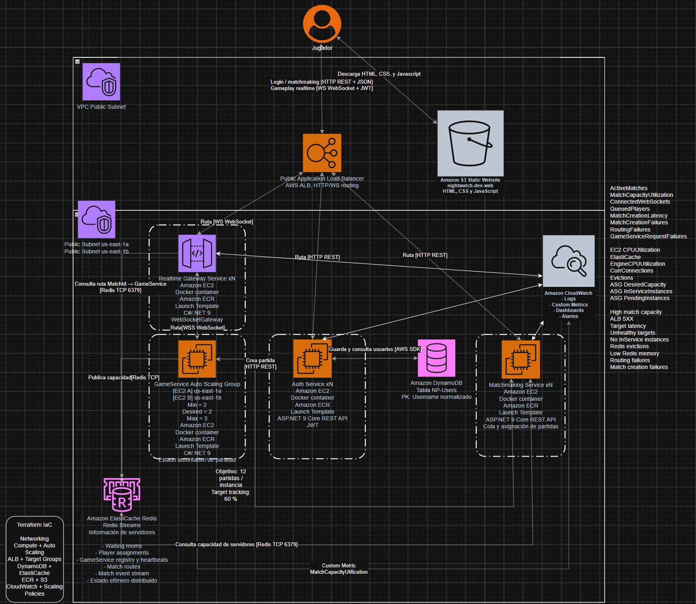
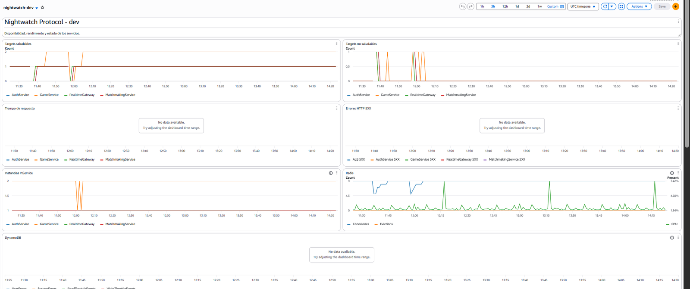

# ☁️ NP-Terraform

Infrastructure as Code (AWS) for [Nightwatch Protocol](https://github.com/Nightwatch-Protocol/nightwatch-protocol).

## What it provisions (modular)
| Module | Resources |
|---|---|
| `network` | VPC, public subnets, route tables, Redis subnets |
| `load-balancer` | Public ALB (HTTP :80) with path rules `/auth`, `/matchmaking`, `/game-ws`, one target group per service with `/health` checks |
| `service-asg` | One **EC2 Auto Scaling Group per service** (Auth, Matchmaking, Gateway, Game), launch template with user-data that pulls the Docker image from ECR, **CPU target-tracking scaling** |
| `ecr` | Image repositories per service |
| `redis` | ElastiCache Redis, reachable only from the services that need it |
| `dynamodb` | User table for the Auth Service |
| `observability` / `monitoring` | CloudWatch log groups and unhealthy-target alarms |
| `web-client` | S3 static website hosting the Unity WebGL build |
| `security-rules.tf` | Least-privilege ingress between services (e.g. Game Service only from Matchmaking and Gateway) |

## What was achieved
The whole backend comes up from code: an ALB in front of independently scalable service groups, shared Redis, DynamoDB, metrics and alarms. Used to test several simultaneous matches under load.

## Deployed topology



- **Game Service:** Auto Scaling Group min 2 / desired 2 / max 3 across two availability zones (`us-east-1a`, `us-east-1b`); CPU target tracking at **60 %**, sized for about **12 matches per instance**
- **Auth, Matchmaking, Gateway:** one ASG each behind the ALB
- **Custom CloudWatch metrics** from the services: `ActiveMatches`, `MatchCapacityUtilization`, `ConnectedWebSockets`, `QueuedPlayers`, `MatchCreationLatency`, `MatchCreationFailures`, `RoutingFailures`, `GameServiceRequestFailures`
- **Alarms:** high match capacity, ALB 5XX, target latency, unhealthy targets, no InService instances, Redis evictions / low memory, routing and match-creation failures

### Dashboard


## Trade-offs
- Two base Game Service instances cost more but reduce risk during traffic peaks
- Reactive scale-out takes about 5 minutes (EC2 start-up), so capacity is pre-provisioned

## Usage
```bash
cp terraform.tfvars.example terraform.tfvars   # edit; never commit this file
terraform init
terraform plan
terraform apply
```
`jwt_key` must be a long random secret.

## Notes / limitations
- The ALB listens on HTTP only; add an ACM certificate and an HTTPS listener to use WSS.
- Services run in public subnets, protected by security groups.
- The S3 website bucket is public by design (static client).

## Part of Nightwatch Protocol
[Main repo](https://github.com/Nightwatch-Protocol/nightwatch-protocol) · [Unity Client](https://github.com/JuanDeRe/Nightwatch-Protocol-Unity-Client) · [Auth](https://github.com/JuanDeRe/NP-AuthService) · [Matchmaking](https://github.com/JuanDeRe/NP-MatchmakingService) · [Gateway](https://github.com/JuanDeRe/NP-RealtimeGateway) · [Game Service](https://github.com/JuanDeRe/NP-GameService) · **Terraform**
